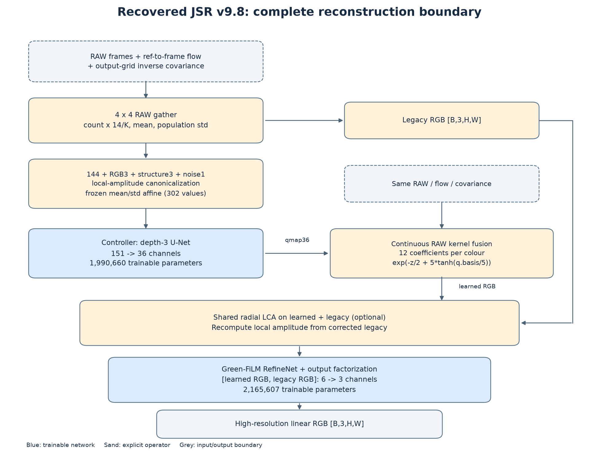
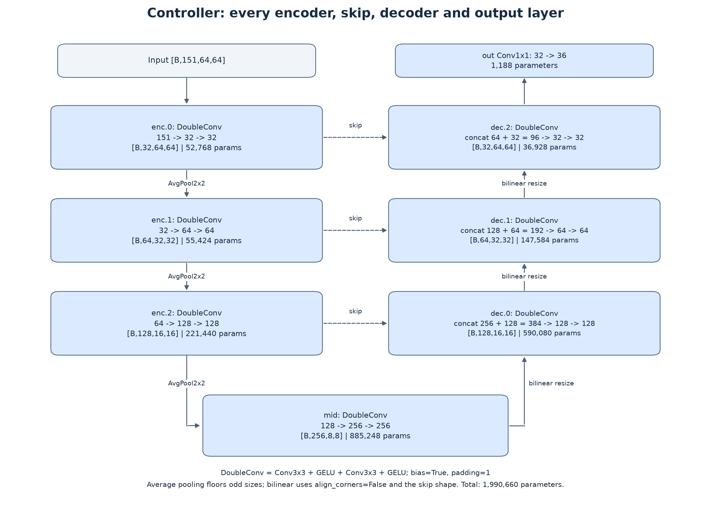
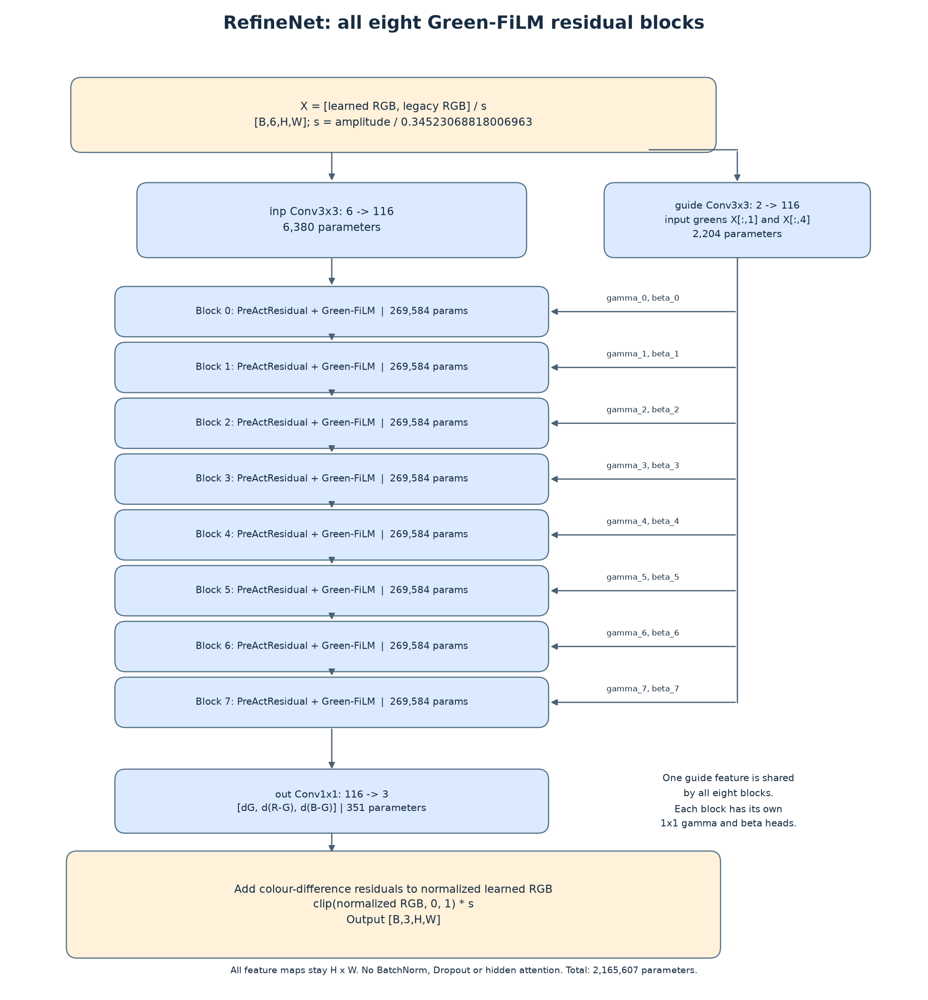

# JSR 完整网络结构、原权重与微调入口

本交付把**已经恢复并验证的 v9.8 重建计算图**完整展开，包含所有可训练层、固定计算、参数名称、维度、K 路由及原权重。它使用作者发布的 v9.7 权重族，v9.8 继续沿用该权重。网络有两个学习模块：Controller 与 Green-FiLM RefineNet；统计、连续融合、归一化和 LCA warp 是显式算子。

单条 K 路径共有 **4,156,267 个可训练参数**：Controller **1,990,660**，RefineNet **2,165,607**。另有固定 mean/std 共 **302** 个数值。所有 K 的网络维度相同，但多数权重不同。旧讲稿启发的七帧 Transformer 与这里的原权重计算图是不同入口。

## 1. 从输入到输出的完整边界



```text
frames[B,K,Hframe,Wframe] + ref→frame flow + inverse covariance
        │
        ├── 4×4 RAW gather / Gaussian base kernel
        │         ├── phase144: count×14/K, mean, population std
        │         └── legacy RGB
        │
        ├── legacy local amplitude + Sobel structure + zero noise channel
        │         └── feature151 → homogeneous normalization → frozen affine
        │                                   │
        │                            Controller U-Net
        │                                   │
        └── same original RAW samples ← qmap36 (12 coefficients / colour)
                    │
             continuous kernel fusion
                    │
                learned RGB                 legacy RGB
                    └──────────┬────────────────┘
                     shared radial LCA warp (optional)
                               │
                     recompute amplitude from legacy
                               │
                     concat [learned RGB, legacy RGB]
                               │
                     factorized Green-FiLM RefineNet
                               │
                     high-resolution linear RGB
```

完整边界输入如下。B 是 batch；K 是输入帧数。示意图默认 native 32×32、输出 64×64。

| 输入 | 张量形状 / 约定 |
|---|---|
| frames | `[B,K,Hframe,Wframe]`，扣黑后的线性 RAW；保留负值；默认 RGGB |
| flow | `[B,K,Hreference,Wreference,2]`，reference→frame 的 `(dx,dy)`，单位 native pixel |
| covariance | `[B,3,Hout,Wout]`，逆协方差 `(xx,xy,yy)`，已位于输出网格 |
| fshift，可选 | `[B,K,4]`：y offset、x offset、有效 height、有效 width |
| color_index，可选 | `[Hframe,Wframe]`，R=0、G=1、B=2；默认 RGGB |
| origin_yx，可选 | 输出 ROI 原点，native pixel 单位；默认 `(0,0)` |
| lca_coefficients_rb，可选 | `[2]` 或 `[B,2]`，R/B 相对 G 的径向采样尺度增量 |
| RGB 输出 | `[B,3,Hout,Wout]`，与 RAW 相同线性单位 |

原输出坐标为 `oy=y/2+y0, ox=x/2+x0`。Controller 的输出高宽均须 ≥8。加载某 K 路由后输入帧数必须对应。当前可训练入口要求已经提供配准流和输出网格协方差；尚未恢复的 RAW 导引、完整配准与协方差网格调度不会自动用猜测填入。

## 2. Controller：全部学习层



每个 DoubleConv 为 `Conv3×3(bias=True,padding=1) → GELU → Conv3×3(bias=True,padding=1) → GELU`。GELU 使用 PyTorch 默认 exact-erf 定义；与公开 WGPU 激活实现的数值差异已经包含在对照报告中。

| 模块 / state 前缀 | 输入→输出通道 | 示例空间尺寸 | 参数数 |
|---|---|---:|---:|
| `controller.enc.0` | 151→32→32 | 64×64 | 52,768 |
| AvgPool2×2，stride2 | 32→32 | 32×32 | 0 |
| `controller.enc.1` | 32→64→64 | 32×32 | 55,424 |
| AvgPool2×2，stride2 | 64→64 | 16×16 | 0 |
| `controller.enc.2` | 64→128→128 | 16×16 | 221,440 |
| AvgPool2×2，stride2 | 128→128 | 8×8 | 0 |
| `controller.mid` | 128→256→256 | 8×8 | 885,248 |
| bilinear resize + concat enc.2 | 256+128=384 | 16×16 | 0 |
| `controller.dec.0` | 384→128→128 | 16×16 | 590,080 |
| bilinear resize + concat enc.1 | 128+64=192 | 32×32 | 0 |
| `controller.dec.1` | 192→64→64 | 32×32 | 147,584 |
| bilinear resize + concat enc.0 | 64+32=96 | 64×64 | 0 |
| `controller.dec.2` | 96→32→32 | 64×64 | 36,928 |
| `controller.out`，Conv1×1 | 32→36 | 64×64 | 1,188 |
| **合计** | | | **1,990,660** |

下采样是 floor average pooling；上采样明确 resize 到对应 skip 的高宽，`mode='bilinear', align_corners=False`。因此奇数尺寸按 floor / resize-to-skip 处理。没有 BatchNorm、Dropout 或注意力层。

DoubleConv 内两层卷积的权重键是 `.0.weight/.0.bias` 和 `.2.weight/.2.bias`。例如 `controller.enc.0.0.weight` 形状 `[32,151,3,3]`。最后 `controller.out.weight=[36,32,1,1]`。Controller 共 15 个卷积层、30 个 weight/bias 张量。

## 3. 36 个控制量如何参与融合

对每个颜色的 12 个系数 q，基函数是：

```text
[1, dy, dx, dy², dx², dy*dx, r², r⁴,
 cos(2πdy), sin(2πdy), cos(2πdx), sin(2πdx)]
```

`r²=dy²+dx²`，`raw=dot(q,basis)`，`delta=5*tanh(raw/5)`。对原 RAW 样本：

```text
z = cov_xx*dx² + 2*cov_xy*dx*dy + cov_yy*dy²
w = exp(-0.5*z + delta)
learned[c] = sum(w*RAW[c]) / sum(w)
```

因此 36 输出是连续核修正，不是 3×4 RGB tap 的 softmax。固定控制量时融合对 RAW 值保持线性。样本索引 / phase 选桶为离散操作，连续权重及 RAW 值有梯度。

## 4. RefineNet：八个残差 / FiLM 块全部展开



进入网络前，令 `a=local_amplitude(post-LCA legacy)`，`s=a/0.34523068818006963`，零幅度使用安全分母。`X=concat(learned,legacy)/s`，共六通道；`G=X[:,[1,4]]` 是两路绿色。

| 模块 / state 前缀 | 运算 | 参数数 |
|---|---|---:|
| `refinenet.inp` | Conv3×3，6→116，padding1 | 6,380 |
| `refinenet.guide` | Conv3×3，2→116，padding1 | 2,204 |
| `body.0` + `gammas.0` + `betas.0` | residual + Green-FiLM | 269,584 |
| `body.1` + `gammas.1` + `betas.1` | 同结构、独立权重 | 269,584 |
| `body.2` + `gammas.2` + `betas.2` | 同结构、独立权重 | 269,584 |
| `body.3` + `gammas.3` + `betas.3` | 同结构、独立权重 | 269,584 |
| `body.4` + `gammas.4` + `betas.4` | 同结构、独立权重 | 269,584 |
| `body.5` + `gammas.5` + `betas.5` | 同结构、独立权重 | 269,584 |
| `body.6` + `gammas.6` + `betas.6` | 同结构、独立权重 | 269,584 |
| `body.7` + `gammas.7` + `betas.7` | 同结构、独立权重 | 269,584 |
| `refinenet.out` | Conv1×1，116→3 | 351 |
| **合计** | | **2,165,607** |

每个 i 块的真实顺序：

```python
u = h + conv2_i(gelu(conv1_i(gelu(h))))
gamma = gamma_i(guide)     # Conv1×1 116→116
beta  = beta_i(guide)      # Conv1×1 116→116
h = u * (1 + 0.1*tanh(gamma)) + beta
```

`guide=refinenet.guide(G)` 只计算一次，并送给八组各自的 gamma/beta。主干有 16 个 3×3 卷积，FiLM 有 16 个 1×1 卷积，另有 inp / guide / out，合计 35 个卷积层、70 个 weight/bias 张量。空间尺寸始终不变；全部卷积有 bias；没有 BatchNorm、Dropout 或隐含注意力。

输出三个量是 `dG,d(R-G),d(B-G)`。基底为归一化后的 learned RGB：

```text
G' = learned_G/s + dG
R' = learned_R/s + dG + d(R-G)
B' = learned_B/s + dG + d(B-G)
RGB_out = clip([R',G',B'],0,1) * s
```

clip 是原计算图的一部分，微调时其区间外梯度也按实际 clamp 行为处理。

## 5. 所有固定计算和 buffer

| 步骤 | 定义 | 可学习权重 |
|---|---|---|
| phase144 | 每色 16 count、16 mean、16 population std；count×14/K | 无 |
| feature RGB | legacy RGB 放入通道 144:147 | 无 |
| feature structure | `.299R+.587G+.114B`，未缩放 Sobel，Gaussian radius8/sigma2；三通道放入147:150 | 无 |
| feature noise | 通道150固定为零 | 无 |
| local amplitude | `sqrt(Gaussian(radius16,sigma4,mean_RGB(legacy²)))`，REFLECT_101 | 无 |
| homogeneous canonicalization | count 0次；mean/std/RGB/noise 1次；structure 2次，分别除 amplitude 的对应幂 | 无 |
| frozen affine | `(canonical-feature_mean)/feature_std` | 302个固定 buffer |
| guide steering covariance | 独立导引上的 Sobel×.25、3×3非归一 box、稳定特征分解与核参数 | 无 |
| radial LCA warp | 给定R/B尺度、整图中心、OpenCV5连续三次插值、BORDER_REFLECT、启用时clip非负 | 无 |

注意 steering covariance 的结构张量与 feature151 的结构张量是两条不同运算，滤波和缩放不同。默认 steering 参数 `.12,.20,4,2` 是解析参数，不是遗漏的训练权重。自动 LCA 估计也不是一个已恢复的神经网络。

## 6. 原权重：K=1–14 的精确路由

| K | Controller 原文件 | RefineNet 原文件 |
|---:|---|---|
| 1 | v97_k01_controller_wgpu.npz | v97_k01_rarm_wgpu.npz |
| 2 | v97_k02_controller_wgpu.npz | v97_k02_rarm_wgpu.npz |
| 3 | v97_k03_controller_wgpu.npz | v97_k03_rarm_wgpu.npz |
| 4 | v97_k04_controller_wgpu.npz | v97_k04_rarm_wgpu.npz |
| 5 | v97_k05_controller_wgpu.npz | v97_k05_rarm_wgpu.npz |
| 6 | v97_k06_controller_wgpu.npz | v97_k06_rarm_wgpu.npz |
| 7 | v97_k07_controller_wgpu.npz | v97_k07_rarm_wgpu.npz |
| 8 | v97_k08_controller_wgpu.npz | v97_k14_rarm_wgpu.npz |
| 9 | v97_k09_controller_wgpu.npz | v97_k14_rarm_wgpu.npz |
| 10 | v97_k10_controller_wgpu.npz | v97_k14_rarm_wgpu.npz |
| 11 | v97_k11_controller_wgpu.npz | v97_k14_rarm_wgpu.npz |
| 12 | v97_k12_controller_wgpu.npz | v97_k14_rarm_wgpu.npz |
| 13 | v97_k14_controller_wgpu.npz | v97_k14_rarm_wgpu.npz |
| 14 | v97_k14_controller_wgpu.npz | v97_k14_rarm_wgpu.npz |

所有路径共用 `local_v7_static_affine_v1.npz`。权重原文件合计 173,064,796 bytes，13 个 Controller、8 个 RefineNet、1份 affine。导出包按共享组件去重，保留来源 NPZ 的文件名、SHA-256、每个 tensor 的名称 / shape / dtype / numel；PT 全部为 FP32 state_dict，不做量化、转置或重新训练。

`catalog/weight_catalog.csv` 枚举全部 952 个唯一导出 tensor，包含原 NPZ key→完整 PyTorch state key 的对应关系；另有一行记录16个 calibration IDs 元数据。`catalog/architecture.json` 包含每层 kernel / stride / padding、实际 forward shape trace 与参数数。卷积布局为 `[out_channels,in_channels,kH,kW]`。单个完整模型 state_dict 有 100 个 weight/bias 张量及两个 affine buffer。

仓库也提供 [逐层架构 JSON](network-kit/architecture.json)、[全部参数映射 CSV](network-kit/weight_catalog.csv) 和 [实际模块树](network-kit/model_repr.txt)。

## 7. 直接加载、查看与修改

在解压后的模型包根目录：

```bash
python -m pip install -e ./source
```

```python
from jsr_repro.network_bundle import load_pretrained_bundle

model = load_pretrained_bundle('weights', k=4)
print(model)
for name, value in model.state_dict().items():
    print(name, tuple(value.shape), value.dtype)

model.train()
result = model(frames, flow, covariance)
loss = (result['rgb'] - target_linear_rgb).abs().mean()
loss.backward()
```

也提供单文件原 K4 checkpoint：

```python
from jsr_repro.recovered_checkpoint import load_recovered_checkpoint
model = load_recovered_checkpoint('checkpoints/pretrained_k04.pt')
```

从原 NPZ 加载的已有接口也保留：`load_recovered_jsr(original_weights_dir,k)`。K13 的两个组件虽然复用 K14，加载后 `expected_frames` 仍为13。

## 8. 微调、冻结与保存

```bash
python -m jsr_repro.finetune_recovered --bundle-dir weights --k 4 --samples examples/engineering_k4.npz --stage joint --steps 1 --lr 1e-6 --output runs/smoke
```

三种阶段：

- `controller`：只更新 Controller，以 learned RGB 监督。
- `refine`：冻结 Controller，只更新 RefineNet，以最终 RGB 监督。
- `joint`：两个网络联合更新，以最终 RGB 监督。

监督 NPZ 包含前述 frames / flow / covariance，以及 `target[3,Hout,Wout]` 或 `[Hout,Wout,3]`。target 必须是与 RAW 相同单位的线性 RGB。实际使用时以独立 GT 和可靠配准 / 标定替换工程示例；附带示例的 target 是原输出的确定性扰动，只用于验证参数更新与保存重载。

输出 `model.pt` 与 `training.json`，保存网络配置、帧数路由、affine、来源、训练阶段和 loss 日志。加载只使用 `torch.load(...,weights_only=True)`。例如：

```python
from jsr_repro.recovered_checkpoint import (
    load_recovered_checkpoint, save_recovered_checkpoint,
)

model = load_recovered_checkpoint('runs/smoke/model.pt')
save_recovered_checkpoint(
    model, 'runs/my_model.pt',
    provenance={'kind': 'fine_tuned', 'dataset': 'my-linear-RAW-pairs'},
)
```

`--initialize runs/smoke/model.pt` 是模型 warm start，开始新的 AdamW；不保存 optimizer/RNG，也不表示精确断点续训。原作者的训练集 / loss / schedule 没有从最终权重中恢复。这里的 L1、round-robin 与默认学习率均为透明的最小工程示例。

## 9. 已验证范围与 v17 附录

上一轮原程序逆向的模块证据、误差和剩余边界见 [REA_RECOVERY.md](REA_RECOVERY.md)。原 WGSL 组合对照的 K4 最终 RGB max abs 为3.397e-6；归一化中间特征保留一项严格误差检查失败，不能把它改写成逐位一致。

v17.3.1 发布包包含 Stormer7、Fast14、K14 三种 backend。本次下载包另附 `extras/v17.3.1-weight-inventory/`，提供选定 `wgpu_reconstruction/weights.npz` 的85个原张量、等值 PT state_dict 和完整清单；v9.8 导出脚本的默认产物只包含 v9.8 部分。该资产的完整调用图、模式消费者及前后处理尚未恢复，仅从名称/shape不能确认；它不能当作可运行的 v17 网络，也不对应 v9.8 的 RecoveredJSR。附录只校验了选定 ZIP 条目的CRC和原NPZ SHA，未重新验证整个v17 ZIP的SHA。

进一步改结构时，先修改对应 PyTorch 类和 checkpoint schema，再重新训练 / 迁移匹配权重。改变通道、层数或前端语义后，严格原权重加载可能拒绝，这能帮助定位实际不兼容的层。
